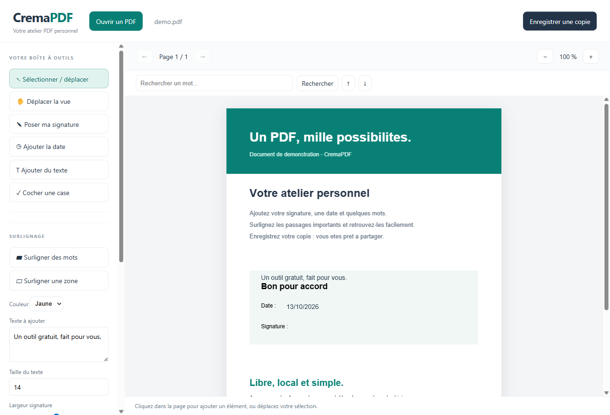

# CremaPDF

**Vos PDF. Votre signature. Tout simplement.**

Un petit atelier PDF gratuit et libre pour Windows : ouvrir un document,
ajouter une signature, une date ou du texte, surligner et enregistrer une copie.
Sans compte, sans abonnement et sans envoi de vos documents à un serveur.

**[Télécharger CremaPDF pour Windows](https://github.com/thibaud-afk/CremaPDF/releases/latest)**



## Installation

1. Téléchargez `CremaPDF Setup 1.1.0.exe` dans les [Releases](https://github.com/thibaud-afk/CremaPDF/releases).
2. Lancez l'installateur. Aucun outil de développement n'est nécessaire.
3. Choisissez votre prénom, dessinez votre signature ou importez une image PNG/JPEG.
4. Vérifiez l'aperçu et validez. Vous pouvez cocher **Ne plus afficher cet accueil**.
5. Cliquez sur **Importer un PDF** et commencez.

Windows 10/11, processeur x64. L'installateur n'est pas signé avec un certificat
d'éditeur ; Windows peut afficher un avertissement de réputation.

## Nouveautés de la version 1.1

La signature est sélectionnée dès sa pose : déplacez-la immédiatement, tirez une des quatre poignées pour la redimensionner, puis utilisez Suppr ou clic droit pour la supprimer. Le clic droit permet aussi de dupliquer un ajout. Les consignes de création et de placement sont maintenant visibles. Un raccourci « Désinstaller CremaPDF » est ajouté au menu Démarrer ; la désinstallation reste accessible dans les applications Windows.

## Ce que vous pouvez faire

| Outil             | Usage                                                                |
| ----------------- | -------------------------------------------------------------------- |
| Signature         | Dessiner ou importer, enregistrer sur ce PC, poser et déplacer       |
| Texte, date, case | Ajouter en un clic ; choisir la taille du texte                      |
| Surlignage        | Sélectionner du texte ou dessiner une zone ; jaune, vert, bleu, rose |
| Recherche         | Chercher un mot et parcourir les résultats du document               |
| Lecture           | Changer de page, zoomer, déplacer la vue                             |
| Export            | Enregistrer une copie PDF contenant les ajouts                       |
| Réglages          | Changer la signature et le prénom, effacer la signature enregistrée  |

Raccourcis : **Ctrl+O** ouvrir · **Ctrl+F** rechercher · **Ctrl+S** enregistrer.

### Ouvrir tous vos PDF avec CremaPDF

Après installation, cliquez sur **Lecteur PDF par défaut**. Dans les paramètres
Windows, recherchez `.pdf` et choisissez **CremaPDF**. Windows exige que vous
validiez ce choix. Les PDF ouverts par double-clic arrivent directement dans
l'application ; une seule instance du logiciel est conservée.

### Des limites claires

Cette première version ajoute des éléments au PDF. Elle ne réécrit pas les
paragraphes d'origine, ne supprime pas réellement du contenu existant et ne
propose pas d'éditeur dédié aux champs de formulaire. Les ajouts sont intégrés
dans la copie exportée : ils ne sont plus des objets déplaçables après réouverture.

La signature est une **image manuscrite**, sans certificat électronique ni
contrôle d'identité. Le contrôle initial vérifie seulement que l'image n'est
pas vide. La recherche et la sélection de mots nécessitent un PDF contenant
du texte ; les scans peuvent être surlignés par zone, mais l'OCR n'est pas inclus.
Les documents protégés doivent être déverrouillés au préalable.

## Confidentialité

Le logiciel fonctionne hors ligne. La signature est chiffrée avec le stockage
sécurisé Windows du compte utilisateur. Le prénom et la préférence d'accueil
restent dans les données locales de l'application. **L'installateur ne contient
aucune signature ni aucun document personnel.** Chaque personne configure son
propre espace. Vous pouvez effacer votre signature depuis la barre latérale.

## Compiler depuis les sources

Prérequis : Windows x64, Node.js 22.12 ou plus récent, pnpm 11.

```powershell
git clone https://github.com/thibaud-afk/CremaPDF.git
cd CremaPDF
pnpm install --frozen-lockfile
node node_modules/electron/install.js
pnpm start
pnpm build
```

L'installateur est généré dans `release/`. Le premier téléchargement des dépendances
et des outils de compilation nécessite Internet. Le logiciel installé fonctionne
ensuite hors ligne. Le code principal est dans `main.cjs`, le pont isolé dans
`preload.cjs`, et l'interface dans `app.js`, `index.html`, `style.css`.

Construit avec [Electron](https://www.electronjs.org/),
[PDF.js](https://mozilla.github.io/pdf.js/) et [pdf-lib](https://pdf-lib.js.org/).
Les composants tiers restent soumis à leurs licences respectives.

## Contribuer

Les retours et améliorations sont les bienvenus dans les Issues et Pull Requests.
N'attachez jamais un document confidentiel : préférez un PDF de démonstration
reproduisant le problème. Pour une faille de sécurité, consultez [SECURITY.md](SECURITY.md).

## Licence et remerciements

Licence [MIT](LICENSE). Vous pouvez utiliser, partager et améliorer ce logiciel.

**Offert avec plaisir par Thibaud CREMADES.**
